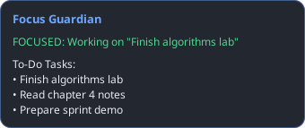

# Focus Guardian


> [!NOTE]
> **AI-Generated Code:** This repository and its codebase were generated with an LLM.

Lightweight companion app that connects to **Google Calendar** & **Google Tasks**, shows a persistent desktop sticky-note widget, and checks your last 5 minutes of tracked activity from [activity-tracker](https://github.com/FilipVelichkovski/activity-tracker) via its local HTTP API (`http://127.0.0.1:7878`, with direct SQLite fallback if `~/.local/share/activity-tracker/activity.db` is unencrypted).



## Requirements

- **[activity-tracker](https://github.com/FilipVelichkovski/activity-tracker)** (required) — must be installed and running to serve the local HTTP API (`http://127.0.0.1:7878`), since `activity.db` is SQLCipher-encrypted.
- **Python 3.10+** with `PySide6` or `PyGObject` (`Gtk 3.0`) for the desktop sticky-note widget.

## Behavior
- **Periodic Check** (`300s` default): checks if you are working on an immediate not-done Google Task **or** one of your configured `allowed_topics`.
- **Distraction Notification**: sends a `notify-send` alert if you are active and neither working on a pending task nor a configured allowed topic.
- **Suppresses Notifications Automatically When:**
  - Snoozed via `cli.py snooze` (or the MCP `snooze` tool)
  - A Google Calendar event is currently ongoing (classes, meetings, etc.)
  - Laptop is **not plugged into a charger** (saves battery)
  - Laptop is **offline**
  - During **quiet hours** (`21:00` – `08:00` by default)
  - You were away / locked / minimized (`< 45s` active time in the last 5 minutes)

## Setup

1. Create a Google Cloud Desktop OAuth2 client (`calendar.readonly` + `tasks.readonly`), download the JSON, and save it to:
   `~/.config/focus-guardian/credentials.json`

2. Authorize once:
   ```bash
   python3 cli.py auth
   ```

3. *(Optional)* Customize settings in `~/.config/focus-guardian/config.json`:
   ```json
   {
     "check_interval_sec": 300,
     "quiet_start_hour": 21,
     "quiet_end_hour": 8,
     "allowed_topics_label": "Study & Research",
     "allowed_topics": ["algorithms", "research", "documentation"]
   }
   ```

4. Check status, test once, or snooze notifications:
   ```bash
   python3 cli.py status
   python3 cli.py check-once --notify
   python3 cli.py snooze --until 16:30 --reason "Meeting prep"
   python3 cli.py unsnooze
   ```

5. Install & start as a `systemd --user` service:
   ```bash
   python3 cli.py install-service
   ```

## MCP Server

`mcp_server.py` exposes Focus Guardian over stdio JSON-RPC 2.0 (`get_status`, `snooze`, `unsnooze`, `check_once`, `sync_agenda`) with zero external dependencies:

```json
{
  "mcpServers": {
    "focus-guardian": {
      "command": "python3",
      "args": ["/path/to/focus-guardian/mcp_server.py"]
    }
  }
}
```
